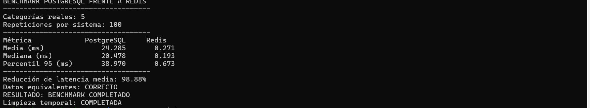
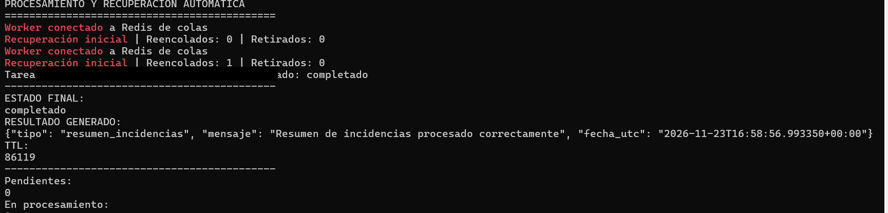
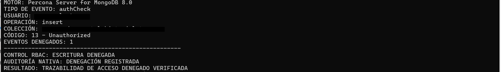

# Redis & MongoDB Security and Performance Lab

**Linux | Docker | Redis 7.4 | Percona Server for MongoDB 8.0 | NoSQL | Security | Performance**

## Project Overview

This project documents a practical laboratory focused on in-memory data storage, NoSQL database administration, access control, persistence, asynchronous processing and performance analysis.

The work was completed during my second-year practical training in Network Computer Systems Administration (ASIR).

The laboratory was divided into two phases:

- **Phase 1 — Redis:** Docker deployment, authentication, memory management, session storage, data caching and asynchronous job processing.
- **Phase 2 — MongoDB:** Document database deployment, persistence, role-based access control and native security auditing.

The public repository focuses on infrastructure administration and technical validation. Private application source code, credentials and operational infrastructure details are excluded.

## Technologies

- Ubuntu Server LTS
- Docker and Docker Compose
- Redis 7.4
- Percona Server for MongoDB 8.0
- PostgreSQL 17 (comparison baseline)
- Python
- Redis CLI and MongoDB Shell
- Linux permissions and access control lists
- NoSQL authentication and RBAC
- Performance benchmarking

## Phase 1 — Redis

### 1. Private Docker Deployment

Redis was deployed inside a private Docker network without publishing port 6379 to the host.

The laboratory used separate Redis instances for caching, sessions and asynchronous job processing.

Container resource limits and protected secret files were included in the deployment design.

### 2. Authentication and Command Restrictions

The Redis caching instance required authentication using a secret stored outside the source code.

Validation included:

- Unauthenticated access rejected with `NOAUTH`.
- Authenticated access returning `PONG`.
- Restrictions on potentially destructive or expensive commands, including `FLUSHALL`, `FLUSHDB` and `KEYS`.
- File permissions restricting access to stored secrets.

### 3. Memory Management and LRU Eviction

The caching instance was configured with:

| Setting | Value |
|---|---|
| Maximum Redis data memory | 64 MiB |
| Eviction policy | `allkeys-lru` |
| Container memory limit | 128 MiB |
| CPU limit | 0.5 CPU |

An independent test container was used to validate automatic eviction under controlled memory pressure.

**Observed test results:**

| Metric | Value |
|---|---:|
| Test memory limit | 8 MiB |
| Synthetic keys inserted | 200 |
| Keys evicted | 112 |
| Keys remaining | 88 |

This test confirmed eviction behavior in a disposable laboratory instance. It was not a production workload benchmark.

### 4. Persistent Session Storage

A separate Redis instance was configured for session persistence.

Its configuration included:

- `noeviction` policy.
- AOF and RDB persistence.
- Persistent Docker volume.
- Protected authentication.
- Session expiration of 30 minutes.

The laboratory validated session storage, positive TTL values and HTTP session continuity.

Session cookie checks observed `HttpOnly` and `SameSite=Lax`. The local HTTP test did not validate the `Secure` cookie attribute for production HTTPS use.

### 5. Data Caching and Performance

Redis was used to cache a small category dataset with a TTL of 60 seconds.

The laboratory verified cache misses, subsequent cache hits, expiration and fallback to PostgreSQL when the cache was unavailable.

A controlled benchmark compared access to equivalent data through PostgreSQL and Redis.

| Metric | PostgreSQL | Redis |
|---|---:|---:|
| Mean | 24.285 ms | 0.271 ms |
| Median | 20.478 ms | 0.193 ms |
| 95th percentile | 38.970 ms | 0.673 ms |
| Measurements | 100 | 100 |

**Observed mean time reduction: 98.88%.**

The comparison measured data access from a laboratory container, not full HTTP response times.

The PostgreSQL route established a new connection for each read, while the Redis route reused a client. The results therefore include different connection overheads and should not be interpreted as a general-purpose database speed comparison.

### 6. Asynchronous Job Queue

A dedicated Redis instance was used for asynchronous jobs.

The solution included:

- Persistent job metadata and queue structures.
- A dedicated worker container.
- Job state tracking.
- Queue processing and acknowledgment logic.
- Recovery of a synthetic interrupted task after worker restart.

The recovery test confirmed that one interrupted task was requeued and completed.

The implementation demonstrated recovery with a single worker, not exactly-once execution guarantees or distributed high availability.

## Phase 2 — MongoDB

### 7. Deployment and Persistence

The document database used **Percona Server for MongoDB 8.0**, a MongoDB-compatible distribution selected for its native auditing capabilities.

The service was deployed with:

- Private Docker network.
- No published database port.
- Persistent Docker volume.
- Authentication enabled.
- Memory and CPU limits.
- Restricted configuration and secret-file permissions.

Two synthetic documents were successfully recovered after a controlled database container restart.

### 8. Role-Based Access Control

Database users were assigned separate permissions for reading and writing documents.

Tests confirmed:

- Read-only user: reading authorized.
- Read-only user: writing rejected with MongoDB error code 13.
- Read/write user: writing and reading authorized.

The laboratory also verified archival and retrieval of demonstration job results.

### 9. Native Security Auditing

Native auditing was enabled for a selected document collection using Percona Server for MongoDB.

Audit validation covered:

- Authorized `find` operation.
- Authorized `insert` operation.
- Unauthorized `insert` operation.
- Audit records containing the expected user, operation, collection and authorization result.

Authorized operations were recorded with result code `0`, and the denied write operation with result code `13`.

Audit records were stored in a persistent JSON log with restrictive permissions.

## Technical Evidence

The following screenshots were captured during the Redis and MongoDB laboratory and sanitized for public documentation.

### 1. Redis vs PostgreSQL — Data Access Benchmark

**Validation:** Controlled comparison of equivalent data-access operations.

The benchmark performed 100 measurements per data source, retrieving five category records.

- PostgreSQL mean: **24.285 ms**
- Redis mean: **0.271 ms**
- Observed reduction: **98.88%**

The PostgreSQL path opened a new connection per read, while the Redis path reused an existing client. These results do not represent full HTTP response times or an isolated comparison of database engine performance.

### 2. Redis — Asynchronous Worker Recovery

**Validation:** Recovery and completion of a synthetic interrupted job.

During the controlled test, the worker was stopped, a demonstration job was placed in the processing state, and the worker was restarted.

The worker recovered one job and completed it successfully. Both pending and processing queues were empty after the test.

This validates recovery in the tested single-worker scenario, not exactly-once execution or distributed fault tolerance.

### 3. MongoDB — Native Security Auditing

**Validation:** An unauthorized write was denied and recorded in the native audit log.

Percona Server for MongoDB 8.0 recorded an `insert` authorization check performed by a read-only user.

The operation was rejected with result code `13` (`Unauthorized`).

This demonstrates both role-based access control and audit traceability for the selected laboratory operation.

For additional technical details, see [Redis Performance Analysis](docs/redis-performance.md), [Asynchronous Job Queue](docs/async-job-queue.md) and [MongoDB Security and Auditing](docs/mongodb-security-auditing.md).

## Security Measures

The laboratory applied multiple security controls:

- Internal Docker networking.
- No direct publication of Redis or MongoDB database ports.
- Authentication for database services.
- Secrets excluded from source control.
- Restricted file permissions.
- Separate Redis instances for distinct workloads.
- Database RBAC.
- Native MongoDB-compatible auditing.
- Unprivileged worker execution.

## Technical Limitations

This project documents educational laboratory results.

- No production workload was tested.
- No distributed high-availability deployment was implemented.
- No exactly-once job processing guarantee was established.
- Complete disaster recovery was not validated.
- End-to-end encryption between all database containers was not demonstrated.
- Performance measurements are specific to the tested environment.
- Redis caching results do not establish overall application speed improvements.

## Skills Demonstrated

- Linux systems administration.
- Docker infrastructure deployment.
- Redis configuration and security.
- Cache management and eviction policies.
- Persistent session management.
- Asynchronous job processing.
- MongoDB-compatible database administration.
- Role-based access control.
- Security auditing and log verification.
- Performance testing and technical troubleshooting.

## Security and Privacy

This repository contains sanitized educational documentation and configuration examples.

Private application code, real service addresses, passwords, session tokens, database contents and operational secrets are intentionally excluded.

## Author

**Erick Conesa Pérez**

Second-year student — Higher Vocational Training in Network Computer Systems Administration (ASIR).

Professional interests: Linux administration, infrastructure, databases, networking and cybersecurity.
